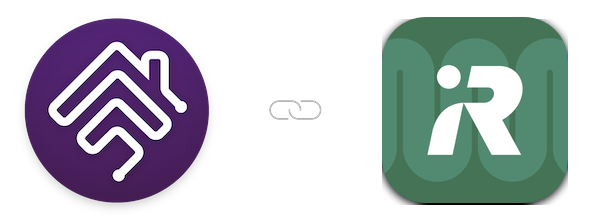

<p align="center">
  
</p>
<p align="center">
  <a href="https://www.o-matic.ai/"></a>
</p>

# Roomb-o-MATIC for Homebridge

Get the modern Matter controls you are missing for your Roomba i5+. Rooms, cleaning modes, and full Matter support.

Matter vacuum for your Roomba on Homebridge. Choose the rooms and the cleaning level: Automatic, Deep Clean, or Quick.

Roomb-o-MATIC is that plugin, from [lucidIT](https://lucidit.io). On Homebridge 2.5 the Roomba shows up in Apple Home as its own Matter vacuum. You pair that vacuum with its own code. The Homebridge bridge code does not add the robot.

The HomeKit fan, dock, battery, and bin stay for controllers that are not using Matter.

## Install

In Homebridge, install **homebridge-roomb-o-matic** from the plugin search, or:

```bash
npm install -g homebridge-roomb-o-matic
```

Homebridge 1.9 through 2.x, including 2.5. Node.js 20, 22, 24, or 26.

Turn Matter on for that Homebridge bridge, then restart.

## Rooms

Apple Home shows your rooms as Matter Service Areas. A selected room starts a room mission. An empty selection cleans the whole map.

Put each room's region id and name in `rooms`, plus `pmapId` and `userPmapvId`.

```bash
roomb-o-matic-list-rooms --ip 192.0.2.10 --blid YOUR_BLID --password YOUR_ROBOT_PASSWORD
```

Close the iRobot app first. If Homebridge is already connected to that robot, stop the plugin for a moment so the robot can accept this connection. The command prints map and room ids only.

## Cleaning level

| Level | What the Roomba does |
| --- | --- |
| Automatic | The robot's own pass setting |
| Deep Clean | Two vacuum passes |
| Quick | One vacuum pass |

These are vacuum levels. The Roomba does not mop, and the plugin does not advertise a mop mode. Each level carries the Matter Vacuum tag, so Apple Home lists Deep Clean and Quick instead of hiding them.

The level you pick applies to a room clean and to a whole-home clean.

## Configure

Use the Roomb-o-MATIC page in Homebridge, or edit `config.json`:

```json
{
  "platform": "Roomb-O-Matic",
  "name": "Roomb-o-MATIC",
  "disableDiscovery": true,
  "enableMatter": "auto",
  "devices": [
    {
      "name": "Downstairs Roomba",
      "blid": "YOUR_BLID",
      "robotpwd": "YOUR_ROBOT_PASSWORD",
      "ipaddress": "192.0.2.10",
      "cleanMode": "automatic",
      "pmapId": "YOUR_PMAP_ID",
      "userPmapvId": "YOUR_USER_PMAPV_ID",
      "rooms": [
        { "id": "1", "name": "Kitchen" },
        { "id": "2", "name": "Hall", "selected": true }
      ]
    }
  ]
}
```

`platform` stays `Roomb-O-Matic`. That string is what Homebridge already has in existing configs. The name people see is Roomb-o-MATIC. `enableMatter` accepts `auto` (default), `on`, or `off`. `auto` publishes the Matter vacuum when that bridge has Matter available.

A saved `devices` list uses local MQTT and skips the iRobot cloud. `disableDiscovery: true` does the same. If cloud discovery fails or comes back empty, accessories Homebridge already cached stay registered, and discovery retries with backoff.

## Password

Close the iRobot app. The robot accepts one local connection at a time.

On an i-series robot such as the i5+, press and hold the **Home** button for about two seconds, until it plays tones. Do not hold both buttons. That gesture is for 900-series robots.

The plugin reads the password on port 8883 and retries while it waits for the button. It keeps a leading `:1:` when the robot sends one. That prefix is part of the password. Dropping it makes MQTT answer "Bad username or password". Capture the password again if a robot saved by an older build fails local login that way.

In Homebridge, open Roomb-o-MATIC, enter the robot IP, and choose **Capture password**. The page does not print the password or BLID. Saving the form writes them into `devices` and turns cloud login off.

From a shell, including `docker exec` without a TTY:

```bash
roomb-o-matic-getpassword --ip 192.0.2.10 --config /var/lib/homebridge/config.json --name "Downstairs Roomba"
```

Add `--blid YOUR_BLID` when the robot does not answer the local announcement. The command does not print the password or BLID.

## Matter pairing

1. In Homebridge, open Settings and turn Matter on for the bridge that runs this plugin. Restart Homebridge.
2. Save the robot on the Roomb-o-MATIC page.
3. Open that page again and use the code under **Matter pairing**. In Apple Home, add an accessory and enter the code, or scan the QR code.

## HomeKit

When Matter is off, the HomeKit fan still starts and stops a clean. Dock, battery, and bin stay on that accessory. Its clean level and selected rooms come from the device config until a Matter controller changes them.

## Development

```bash
npm install
npm test
npm run lint
npm run build
```

Do not put real BLIDs, passwords, Matter pairing codes, or personal addresses in this repository.

This is Roomb-o-MATIC for Homebridge, from lucidIT. It is not the `homebridge-plugins/homebridge-roomba` plugin.

Roomba and iRobot marks are not lucidIT's, and this project is not affiliated with iRobot.

The Homebridge and iRobot marks are theirs.
